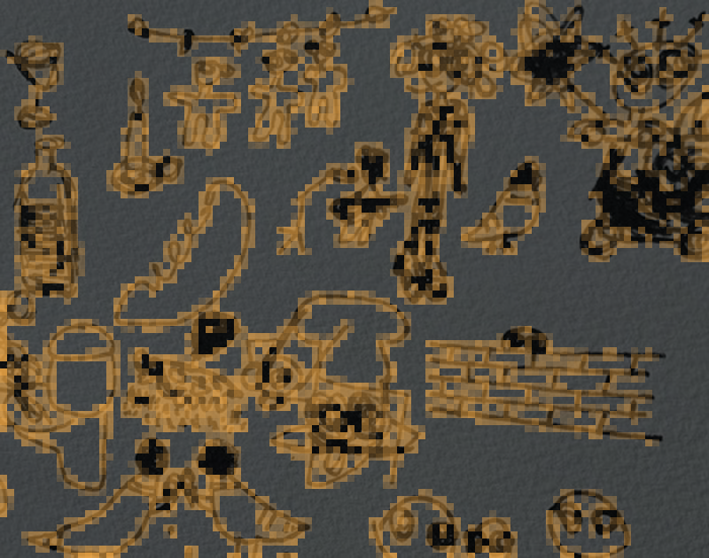
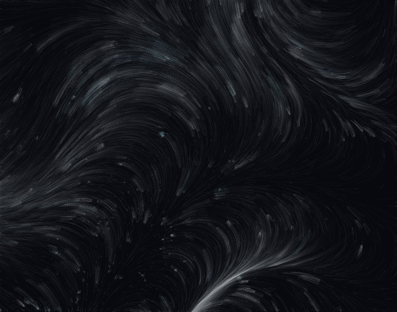

# Swarm Gaze

> What does a machine notice when it looks at a work of art?

**Swarm Gaze** is an early study in computational art. A swarm of virtual flies explores an image, lingers where something stands out, and turns its attention into flowing colour, like data pigment.

| The swarm's attention on my drawing | Its gaze as data pigment |
| --- | --- |
|  |  |

The project has two versions:

- **Browser (`index.html`)**: an interactive piece. Open it (or the GitHub Pages link) and upload any image to watch the swarm look at it.
- **Python (`swarm_gaze.py`)**: the research version. It renders a video and saves the swarm's attention map for analysis.

### Run the Python version

```bash
pip install -r requirements.txt
python swarm_gaze.py                          # uses my drawing in assets/drawing.jpg
python swarm_gaze.py --image my_art.jpg --frames 600 --flies 60 --seed 7
```

Outputs: `swarm_gaze.mp4` (the moving piece), `pigment.png` (last frame), `attention.png` (heat map of where the swarm lingered) and `attention.npy` (the raw attention grid).

## How it works

1. **Noticing.** The image is turned into a salience map: strong edges and saturated colour. This is a crude kind of attention, with no feeling behind it.
2. **Lingering.** A swarm moves over the map using a simplified version of Dispersive Flies Optimisation (DFO). Flies stay longer where the image stands out, then lose interest (an inhibition map) and move on. Where they linger is what the machine has "noticed". A small panel shows this as a heat map.
3. **Pigment.** Each fly releases particles that carry the colour it is looking at. Near a line, particles flow along the direction of that line; in empty space, a gentle wind carries them. They fade over time, so each artwork leaves its own moving trace of the swarm's gaze. (In the Python version; the browser version still uses only the wind.)

## Carried: carrying, not imitating

> Can a machine carry a human feeling, instead of imitating one?

`carried.html` gives the machine no mood of its own. A person draws one line, the way they feel right now. The machine measures that gesture (pace, unsteadiness, duration, pauses, turning, direction) and carries it through the lines of an artwork as flowing light. Near a line of the drawing, light follows the line; elsewhere it follows the gesture. The gesture's rhythm, with its pauses, keeps repeating like breath. Each new gesture can be layered on top.

Open `carried.html` in a browser. The page starts with an example gesture drawn by code, clearly labelled, until a person draws their own.

## Machine Feels: a very simple prototype

> If a machine learns what people feel in front of art, what would it draw?

`machine_feels.py` is the simplest version of that idea. It does not copy the artwork; it draws its own picture.

1. **Look**: reads a few qualities of the artwork (warmth, brightness, colour, line energy, contrast) and its palette.
2. **Feel**: guesses which of the 9 ArtEmis emotions the work evokes. Until it is trained on real people's responses, this step uses a small hand-made starter rule, clearly labelled as *not human data*.
3. **Draw**: a flock of birds (boids) draws an original picture. The feeling decides how they fly (speed, closeness, restlessness) and how their colours shift; the artwork only decides where they start and which palette they borrow.
4. **Learn**: `python machine_feels.py learn --artemis artemis.csv --images wikiart/` fits the feel step on ArtEmis, so the machine's "feelings" come from people. Not run yet.

```bash
python machine_feels.py look-and-draw assets/drawing.jpg
```

Outputs in `out_feels/`: `machine_feelings.png`, `machine_drawing.png`, `machine_drawing.mp4`, `run.json`.

The machine does not feel anything. Whatever it "feels" is borrowed from us.

Reference: Achlioptas, P. et al. (2021). *ArtEmis: Affective Language for Visual Art*. CVPR.

## Bee Gaze: learning from an artist

`bee_gaze.py` adds learning and a second swarm from nature.

1. **Collect**: downloads ~100 public-domain (CC0) works by one artist from The Met Open Access API. Default: Katsushika Hokusai.
2. **Learn**: cuts every work into small patches and clusters them (PCA + k-means) into a vocabulary of 64 marks. Rarer marks count as more "signature".
3. **Look**: scores each region of a target image by how much it resembles those signature marks. Empty paper has no nectar.
4. **Forage**: an Artificial Bee Colony (employed, onlooker and scout bees) searches that map. Nectar is used up where bees feed and slowly regrows.
5. **Paint**: every feeding leaves one learned mark, so the bees build a new image from what the machine learned.
6. **Humans** (planned): compare the bees' visits with real human responses. Not implemented yet; no human data is simulated.

Run it in Google Colab with `bee_gaze_colab.ipynb`, or locally:

```bash
pip install -r requirements.txt scikit-learn requests
python bee_gaze.py collect --artist "Katsushika Hokusai" --n 100
python bee_gaze.py run --target assets/drawing.jpg
```

Outputs in `out/`: the learned vocabulary, the learned attention map, the bees' visit map, the bees' painting, a video of the painting being made, and `bee_visits.npy` for analysis.

Reference: Karaboga, D. (2005). *An idea based on honey bee swarm for numerical optimization*. Technical Report TR06, Erciyes University.

## Controls

| Control | Effect |
| --- | --- |
| Flies | Size of the swarm |
| Restlessness | Disturbance threshold: chance that a fly jumps to a random place |
| Flow speed | How fast the pigment drifts |
| Trail length | How slowly the pigment fades |

## Next steps

- Replace the hand-made salience map with the attention of a trained vision model.
- Run the swarm over a collection of artworks and compare where it looks with where people report an emotional response.
- Rebuild the pipeline in Python for analysis, and render longer video pieces.

## References

- al-Rifaie, M. M. (2014). *Dispersive Flies Optimisation*. Proceedings of FedCSIS 2014, pp. 529–538.
- al-Rifaie, M. M. & Bishop, J. M. (2013). *Swarmic Paintings and Colour Attention*. EvoMUSART 2013.
- Visual language inspired by the data-pigment works of Refik Anadol.

## About

Prototype by İlayda Yılmaz, MSc Data Science, University of Greenwich, October 2026.
Built with the help of an AI coding assistant.

The default image (`assets/drawing.jpg`) is my own ink drawing. Images you upload in the browser stay in your browser and are never sent anywhere.
